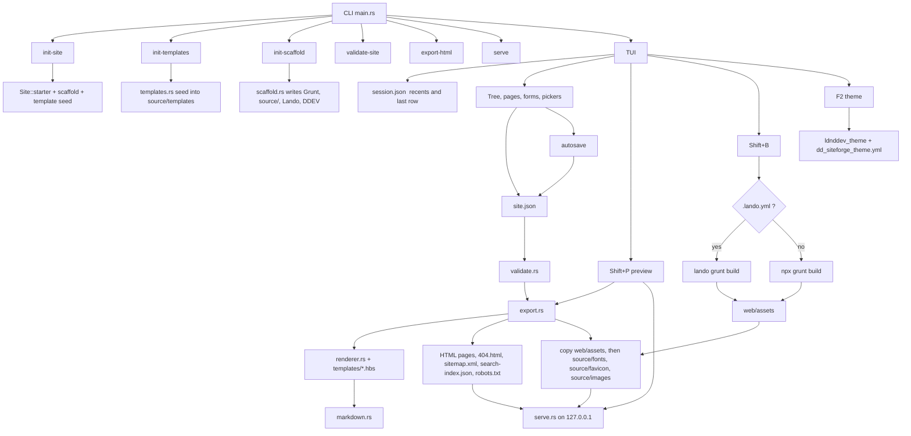

# dd_siteforge

Terminal-UI CMS for authoring framework-native static pages. One Rust binary edits a typed site tree, exports HTML, and leaves the result as a static folder you can host anywhere.

**Tutorial (setup, TUI walkthrough, screenshots):** [ldnddev.github.io/dd_siteforge](https://ldnddev.github.io/dd_siteforge/).

The product spec is [docs/SPEC.md](docs/SPEC.md). The theme and shell contract is [LDNDDEV_TUI_VISUAL_STANDARD.md](LDNDDEV_TUI_VISUAL_STANDARD.md).

## Install

Picks the Linux or macOS binary for this machine (x86_64 or aarch64) from GitHub Releases. The download is refused unless its published SHA-256 checksum matches.

```bash
curl -fsSL https://raw.githubusercontent.com/ldnddev/dd_siteforge/master/install.sh | bash
```

Installs `$HOME/.local/bin/dd_siteforge` and writes the default theme to `$HOME/.config/ldnddev/dd_siteforge_theme.yml` only when that file is missing. Pin a version with `--version`, or override `PREFIX` / `BIN_DIR` / `CONFIG_DIR`.

```bash
curl -fsSL https://raw.githubusercontent.com/ldnddev/dd_siteforge/master/install.sh | bash -s -- --version v1.29.3
curl -fsSL https://raw.githubusercontent.com/ldnddev/dd_siteforge/master/install.sh | bash -s -- uninstall
```

From a clone, `./install.sh` builds with cargo. Use `--from-release` to download a binary instead.

```bash
./install.sh                      # cargo build --release
./install.sh --from-release       # same as the curl one-liner
cargo install --path .            # ~/.cargo/bin
./install.sh uninstall
```

## Quick start

```bash
dd_siteforge init-site site.json --name my-site
lando start && lando npm install && lando grunt build
dd_siteforge
```

`dd_siteforge` in a folder with `site.json` opens the TUI. `dd_siteforge site.json` and `dd_siteforge tui site.json` still work. Recents and the last page/tree row live in `~/.config/ldnddev/dd_siteforge/session.json`.

In the TUI: `F1` help, `?` find, `:` command palette, `Shift+E` export, `Shift+P` preview, `Shift+B` build CSS/JS, `Ctrl+Q` quit. Put images in `./source/images/`.

`Shift+B` runs `lando grunt build` when `.lando.yml` is present, otherwise `npx grunt build`. Preview binds `127.0.0.1` and re-exports into the same local server on the next save.

## Commands

| Command | What it does |
|---|---|
| `dd_siteforge` / `tui [site.json]` | Open the editor. With no file, and no `./site.json`, show the open picker. |
| `init-site <site.json> [--name slug]` | Write a starter site and seed the Grunt/Lando/DDEV kit plus Handlebars. |
| `init-templates [site.json] [--force] [--name tpl]` | Copy templates into `source/templates/`. Existing files stay unless `--force`. |
| `init-scaffold [site.json] [--force] [--global] [--name slug]` | Seed the build kit. `--global` writes `~/.config/ldnddev/dd_siteforge/`. |
| `validate-site <site.json>` | Print validation errors and exit 1 when any remain. |
| `export-html <site.json> <dir>` | Refuse an invalid site, then write HTML, `sitemap.xml`, `search-index.json`, `robots.txt`, and `404.html`. |
| `serve <site.json> [--port 8765] [--output-dir rel]` | Export, then serve on `127.0.0.1`. A relative output dir must stay inside the site. |
| `show-site <site.json>` | Print the parsed site as JSON. |

`export-html` may write to any directory you name. `serve` and the TUI keep a relative export path inside the site folder. Page slugs are kebab-case segments joined by `/`. An unsafe slug is not written.

## How a site is built

`site.json` is the document. Export renders each page through the Handlebars templates, prefixes nested-page asset URLs, and copies built CSS/JS plus fonts, favicons, and `source/images/`. When `.lando.yml` is present, CSS and JS come from `lando grunt build` (`web/assets/`). Otherwise use `npx grunt build`. `grunt build` copies `source/fonts` to `web/assets/fonts`. `grunt favicon` rebuilds favicons from `source/favicon/favicon.png` and is separate from `grunt build`.

Author markdown in copy fields. The exporter keeps CommonMark plus the class/id blocks the templates expect (`{.dd-img}`). Raw `script`, `style`, and `iframe` in those fields are author content (embedded forms and JSON-LD), not stripped.

## Repository

```mermaid
flowchart TD
  root["dd_siteforge"]

  root --> src["src/  editor, model, export"]
  root --> templates["templates/  *.hbs page and component templates"]
  root --> source["source/  kit seeded by init-site"]
  root --> crates["crates/ldnddev_theme/  theme loader"]
  root --> docs["docs/  GitHub Pages tutorial"]
  root --> gh[".github/workflows/  pages.yml, release.yml"]
  root --> meta["Cargo.toml, Cargo.lock, install.sh, Gruntfile.js, package.json, .lando.yml, .ddev/, dd_siteforge_theme.yml, LICENSE"]
  root --> specs["README.md, Architecture.md, docs/SPEC.md, LDNDDEV_TUI_VISUAL_STANDARD.md"]

  src --> main["main.rs  CLI"]
  src --> model["model.rs  site, pages, components"]
  src --> validate["validate.rs"]
  src --> storage["storage.rs  site.json"]
  src --> session["session.rs"]
  src --> markdown["markdown.rs"]
  src --> renderer["renderer.rs"]
  src --> tplmod["templates.rs  bundled Handlebars"]
  src --> export["export.rs"]
  src --> search["search_index.rs"]
  src --> serve["serve.rs  127.0.0.1 preview"]
  src --> scaffold["scaffold.rs  embedded kit"]
  src --> build["asset_build.rs"]
  src --> health["health.rs"]
  src --> tui["tui/"]

  tui --> tevents["events.rs, draw.rs, help.rs"]
  tui --> ttree["tree/  layout tree"]
  tui --> tpages["pages.rs  page tree"]
  tui --> tform["editform/  field contracts"]
  tui --> tmodals["modals/  forms, export, pickers"]
  tui --> tdetails["details/  ASCII blueprint"]
  tui --> trest["find.rs, palette.rs, theme.rs, grunt.rs, tests.rs"]

  source --> scss["scss/  style.scss, components, elements, partials, regions, vendors"]
  source --> js["js/  main.js, components, vendors/sal.js"]
  source --> fonts["fonts/  Lato woff and woff2"]
  source --> favicon["favicon/"]
  source --> images["images/  author files, not embedded"]
  source --> axe["vendors/axe/  in-page axe panel"]

  docs --> tutorial["index.html, 404.html, images/*.png, capture.sh, SCREENSHOTS.md"]
```



`site.json`, `site.json.backup`, and `web/` are local working files. They are gitignored. `target/` is the Cargo build directory.

## App



Field contracts live in `src/model.rs`. Forms live in `src/tui/editform/`. HTML lives in `templates/dd-*.hbs`. Checks live in `src/validate.rs`. There is no separate component-catalog directory.

## Tests

```bash
cargo test -q
```

`dd_siteforge` is a binary crate. Use `cargo test`, not `cargo test --lib`.

## License

MIT License.
