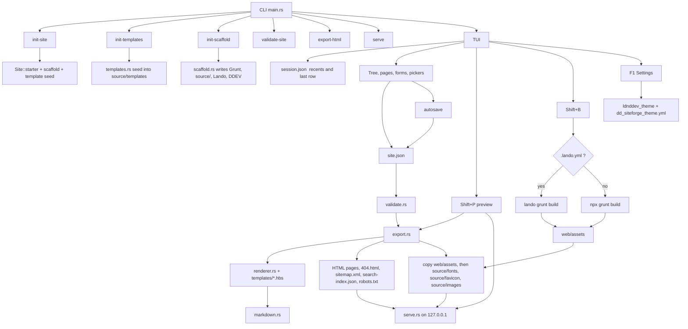

# dd_siteforge

Terminal-UI CMS for authoring framework-native static pages. One Rust binary edits a typed site tree, exports HTML, and leaves the result as a static folder you can host anywhere.

**Tutorial (setup, TUI walkthrough, screenshots):** [ldnddev.github.io/dd_siteforge](https://ldnddev.github.io/dd_siteforge/).

The product spec is [docs/SPEC.md](docs/SPEC.md). The theme and shell contract is [LDNDDEV_TUI_VISUAL_STANDARD.md](LDNDDEV_TUI_VISUAL_STANDARD.md).

## Install

Picks the Linux or macOS binary for this machine (x86_64 or aarch64) from GitHub Releases. The download is refused unless its published SHA-256 checksum matches.

```bash
curl -fsSL https://raw.githubusercontent.com/ldnddev/dd_siteforge/master/install.sh | bash
```

With a terminal to answer, the script asks whether to install the terminal app, the desktop window, or both. With no terminal, it installs the terminal app. That writes `$HOME/.local/bin/dd_siteforge` and the default theme at `$HOME/.config/ldnddev/dd_siteforge_theme.yml` only when that file is missing. On Linux it also writes `${XDG_DATA_HOME:-$HOME/.local/share}/applications/dd_siteforge.desktop` (`Terminal=true`) so the TUI shows in the application menu, and copies the icon when the package includes `source/favicon/web-app-manifest-512x512.png`. A prefix outside `$HOME` uses `$PREFIX/share/applications`. Pin a version with `--version`, or override `PREFIX` / `BIN_DIR` / `CONFIG_DIR` / `XDG_DATA_HOME`.

```bash
./install.sh --tui          # terminal app
./install.sh --gui          # desktop window only
./install.sh --both         # both binaries and both launchers
./install.sh --uninstall    # asks the same question; no terminal removes both
```

`./install.sh --uninstall` removes the chosen binaries and their launchers. It leaves the theme, the icon, and `~/.config/ldnddev/dd_siteforge/` (session and scaffold) in place. Use the same `PREFIX`, `BIN_DIR`, `CONFIG_DIR`, and `XDG_DATA_HOME` as the install. `INSTALL_GUI=1` is the same as `--both`.

```bash
curl -fsSL https://raw.githubusercontent.com/ldnddev/dd_siteforge/master/install.sh | bash -s -- --version v1.32.0
curl -fsSL https://raw.githubusercontent.com/ldnddev/dd_siteforge/master/install.sh | bash -s -- --uninstall --tui
```

From a clone, `./install.sh` builds with cargo. Use `--from-release` to download a binary instead.

```bash
./install.sh --tui                # cargo build --release
./install.sh --from-release --tui # same as the curl one-liner
cargo install --path .            # ~/.cargo/bin
./install.sh --uninstall --tui
```

For the desktop editor, see [GUI](#gui).

## GUI

The GUI is a desktop editor for the same `site.json` sites as the TUI. The binary is `dd_siteforge-gui` (Cargo package `dd_siteforge_gui`).

### Install

You need Rust 1.85 or newer (edition 2024) and a working Vulkan driver.

On Arch:

```bash
sudo pacman -S --needed base-devel git rustup wayland libxkbcommon libxkbcommon-x11 vulkan-icd-loader vulkan-headers fontconfig libxcb libx11 libxcursor libxi libxrandr
rustup default stable
```

On Debian or Ubuntu:

```bash
sudo apt-get update
sudo apt-get install -y --no-install-recommends \
  build-essential \
  git \
  curl \
  pkg-config \
  libwayland-dev \
  libxkbcommon-dev \
  libxkbcommon-x11-dev \
  libvulkan-dev \
  libfontconfig1-dev \
  libxcb1-dev \
  libx11-dev \
  libxcursor-dev \
  libxi-dev \
  libxrandr-dev
curl --proto '=https' --tlsv1.2 -sSf https://sh.rustup.rs | sh
. "$HOME/.cargo/env"
```

From a clone, build and install with:

```bash
./install.sh --gui
```

That runs `cargo build --release -p dd_siteforge_gui`, installs `~/.local/bin/dd_siteforge-gui`, and on Linux writes the application-menu launcher `~/.local/share/applications/dd_siteforge-gui.desktop` (`Terminal=false`, `StartupWMClass=dev.ldnddev.dd_siteforge`). It does not replace the terminal app. `./install.sh --both` installs both binaries and both launchers. You can run the same Cargo command yourself if you only need the binary in `target/release/`.

`./install.sh --from-release --gui` downloads a prebuilt glibc GUI binary when a release includes one. Those assets are Linux only (`x86_64-unknown-linux-gnu` and `aarch64-unknown-linux-gnu`). `--both` downloads the musl TUI and the glibc GUI as two archives. There is no macOS GUI release, and the GUI is not tested in CI on macOS, so build it on Linux. Tags before v1.32.0 have no GUI asset. For those, use `./install.sh --gui` from a clone.

Remove the GUI binary and its launcher with:

```bash
./install.sh --uninstall --gui
```

That leaves `gui.json`, the theme, and the rest of `~/.config/ldnddev/dd_siteforge/` in place.

### Launch

```bash
dd_siteforge-gui [site path]
```

`site path` can be a folder or a `site.json` file. A folder opens the `site.json` inside it. With no path, the GUI opens `./site.json` when that file exists in the current directory. On Linux you can also open it from the application menu.

### Keys

`F1` opens Settings, a panel on the right half of the window. Theme, density, and Vim keys are at the top. Keyboard shortcuts are the section below them, in the same scroll. `F2`, `Ctrl+/`, and `Ctrl+,` open that same panel. `F1` again, or Escape, closes it. The GUI and the TUI share this panel and the same keymap.

A few of the keys:

- `F1` opens Settings
- `Ctrl+P` preview
- `F5` refresh preview
- `Ctrl+K` command palette (also the Search field in the title bar)
- `Ctrl+Q` quit

Vim keys are on by default. In the outline, sidebar, lists, and pickers, `j` `k` move, `g` `G` go to first or last, and `h` `l` collapse or expand. Turn them off in Settings. They are never active inside text fields.

### Preferences (`gui.json`)

GUI-only preferences live in `$XDG_CONFIG_HOME/ldnddev/dd_siteforge/gui.json` (default `~/.config/ldnddev/dd_siteforge/gui.json`). They are not stored in `site.json`. If the file is missing, the app writes one with the defaults below.

| Key | Type | Default | What it stores |
|---|---|---|---|
| `density` | `"comfortable"` or `"compact"` | `"comfortable"` | Control spacing |
| `vim_keys` | boolean | `true` | Vim movement keys in lists and trees |
| `reduced_motion` | boolean | `false` | Less UI motion |

`reduced_motion` has no control in Settings yet. Edit `gui.json` to change it.

### Hyprland / Omarchy

The windows use these app ids so you can write window rules (for example, to float the preview):

- Main window: `dev.ldnddev.dd_siteforge`
- Preview companion: `dev.ldnddev.dd_siteforge.preview`

The GUI launcher `~/.local/share/applications/dd_siteforge-gui.desktop` sets `StartupWMClass=dev.ldnddev.dd_siteforge`. The preview companion opens at 360×248 (minimum 320×200).

Example Hyprland rule for the preview window (Hyprland 0.53+ syntax, as used in current Omarchy):

```
windowrule = float on, match:class ^(dev\.ldnddev\.dd_siteforge\.preview)$
```

Use the main window id the same way if you want a rule for the editor itself.

## Quick start

```bash
dd_siteforge init-site site.json --name my-site
lando start && lando npm install && lando grunt build
dd_siteforge
```

`dd_siteforge` in a folder with `site.json` opens the TUI. `dd_siteforge site.json` and `dd_siteforge tui site.json` still work. Recents and the last page/tree row live in `~/.config/ldnddev/dd_siteforge/session.json`.

In the TUI: `F1` opens Settings (theme on top, shortcuts below, on the right half). `F2` opens the same sheet. `?` find, `:` command palette, `Shift+E` export, `Shift+P` preview, `Shift+B` build CSS/JS, `Ctrl+Q` quit. Put images in `./source/images/`. The footer starts with `F1:Settings`.

`Shift+B` runs `lando grunt build` when `.lando.yml` is present, otherwise `npx grunt build`. Preview binds `127.0.0.1` and re-exports into the same local server on the next save.

## Commands

| Command | What it does |
|---|---|
| `dd_siteforge` / `tui [site.json]` | Open the editor. With no file, and no `./site.json`, show the open picker. |
| `init-site <site.json> [--name slug]` | Write a starter site and seed the Grunt/Lando/DDEV kit plus Handlebars. |
| `init-templates [site.json] [--force] [--name tpl]` | Copy templates into `source/templates/`. Existing files stay unless `--force`. |
| `init-scaffold [site.json] [--force] [--global] [--name slug]` | Seed the build kit. `--global` writes `~/.config/ldnddev/dd_siteforge/`. |
| `validate-site <site.json>` | Print validation errors and exit 1 when any remain. |
| `export-html <site.json> <dir>` | Refuse an invalid site, then write HTML, `sitemap.xml`, `search-index.json`, `robots.txt`, and `404.html`. |
| `serve <site.json> [--port 8765] [--output-dir rel]` | Export, then serve on `127.0.0.1`. A relative output dir must stay inside the site. |
| `show-site <site.json>` | Print the parsed site as JSON. |

`export-html` may write to any directory you name. `serve` and the TUI keep a relative export path inside the site folder. Page slugs are kebab-case segments joined by `/`. An unsafe slug is not written.

## How a site is built

`site.json` is the document. Export renders each page through the Handlebars templates, prefixes nested-page asset URLs, and copies built CSS/JS plus fonts, favicons, and `source/images/`. When `.lando.yml` is present, CSS and JS come from `lando grunt build` (`web/assets/`). Otherwise use `npx grunt build`. `grunt build` copies `source/fonts` to `web/assets/fonts`. `grunt favicon` rebuilds favicons from `source/favicon/favicon.png` and is separate from `grunt build`.

Author markdown in copy fields. The exporter keeps CommonMark plus the class/id blocks the templates expect (`{.dd-img}`). Raw `script`, `style`, and `iframe` in those fields are author content (embedded forms and JSON-LD), not stripped.

## Repository

```mermaid
flowchart TD
  root["dd_siteforge"]

  root --> src["src/  TUI and CLI"]
  root --> core["crates/dd_siteforge_core/  site model, export, init"]
  root --> templates["templates/  *.hbs page and component templates"]
  root --> source["source/  kit seeded by init-site"]
  root --> crates["crates/ldnddev_theme/  theme loader"]
  root --> docs["docs/  GitHub Pages tutorial"]
  root --> gh[".github/workflows/  ci.yml, pages.yml, release.yml"]
  root --> meta["Cargo.toml, Cargo.lock, install.sh, Gruntfile.js, package.json, .lando.yml, .ddev/, dd_siteforge_theme.yml, LICENSE"]
  root --> specs["README.md, Architecture.md, docs/SPEC.md, LDNDDEV_TUI_VISUAL_STANDARD.md"]

  src --> main["main.rs  CLI"]
  src --> tui["tui/"]

  core --> model["model.rs  site, pages, components"]
  core --> validate["validate.rs"]
  core --> storage["storage.rs  site.json"]
  core --> session["session.rs"]
  core --> markdown["markdown.rs"]
  core --> renderer["renderer.rs"]
  core --> tplmod["templates.rs  bundled Handlebars"]
  core --> export["export.rs"]
  core --> search["search_index.rs"]
  core --> serve["serve.rs  127.0.0.1 preview"]
  core --> scaffold["scaffold.rs  embedded kit"]
  core --> build["asset_build.rs"]
  core --> health["health.rs"]
  core --> cform["editform/ and cursor.rs  field contracts"]
  core --> kinds["component_kind.rs and labels.rs"]

  tui --> tevents["events.rs, draw.rs, help.rs"]
  tui --> ttree["tree/  layout tree"]
  tui --> tpages["pages.rs  page tree"]
  tui --> tmodals["modals/  forms, export, pickers"]
  tui --> tdetails["details/  ASCII blueprint"]
  tui --> trest["find.rs, palette.rs, theme.rs, grunt.rs, tests.rs"]

  source --> scss["scss/  style.scss, components, elements, partials, regions, vendors"]
  source --> js["js/  main.js, components, vendors/sal.js"]
  source --> fonts["fonts/  Lato woff and woff2"]
  source --> favicon["favicon/"]
  source --> images["images/  author files, not embedded"]
  source --> axe["vendors/axe/  in-page axe panel"]

  docs --> tutorial["index.html, 404.html, images/*.png, capture.sh, SCREENSHOTS.md"]
```



`site.json`, `site.json.backup`, and `web/` are local working files. They are gitignored. `target/` is the Cargo build directory.

## App



Field contracts live in `src/model.rs`. Forms live in `src/tui/editform/`. HTML lives in `templates/dd-*.hbs`. Checks live in `src/validate.rs`. There is no separate component-catalog directory.

## Tests

```bash
cargo test -q
```

`dd_siteforge` is a binary crate. Use `cargo test`, not `cargo test --lib`.

## License

MIT License.
